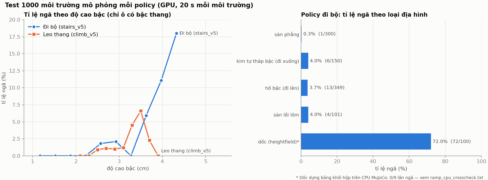

# Log test BIPED-C3: 1000 môi trường mô phỏng

Ngày 23/11/2026, mỗi policy đang dùng được test trên **1000 môi trường mô phỏng chạy song song** trên GPU
(RTX 4060 Laptop). Mỗi môi trường chạy một lượt 20 giây. Môi trường test giữ đúng điều kiện lúc train:
- địa hình gồm mọi loại và mọi độ cao bậc;
- lệnh tốc độ ngẫu nhiên;
- khối lượng, trọng tâm, ma sát khớp thay đổi ngẫu nhiên;
- robot bị xô đẩy;
- servo có độ trễ.

Seed cố định là 2026, chạy lại sẽ ra đúng kết quả này.

| Policy | File đang cài | Checkpoint |
|---|---|---|
| Đi bộ | `policies-biped60/alpha_walking.onnx` | `stairs_v5` / `model_9800.pt` |
| Leo thang | `policies-biped60/climb.onnx` | `climb_v5` / `model_11600.pt` |

## Kết quả chính

| | Đi bộ (`stairs_v5`) | Leo thang (`climb_v5`) |
|---|---|---|
| Số môi trường | 1000 | 1000 |
| **Ngã** | **96 (9,6%)**. Không tính dốc heightfield: 24/900 (2,7%) | **17 (1,7%)** |
| Trụ hết 20 s | 892 | 884 |
| Đi ra hết rìa bản đồ (không phải lỗi) | 12 | 99 |
| Thời gian trụ trung bình | 18,8 s | 18,7 s |
| Sai số tốc độ tiến (trung bình) | 0,125 m/s | 0,082 m/s |
| Sai số tốc độ quay (trung bình) | 0,40 rad/s | 0,30 rad/s |
| Quãng đường trung bình | 1,5 m (lệnh đổi hướng liên tục) | 8,7 m |
| Lùi bước (lùi > 3 cm) | — | 0,03 lần mỗi môi trường |

### Theo loại địa hình

| Địa hình | Đi bộ: ngã | Leo thang: ngã | Ghi chú |
|---|---|---|---|
| Sàn phẳng | 1/300 (0,3%) | 1/101 (1,0%) | |
| Kim tự tháp bậc (xuất phát trên đỉnh, đi xuống) | 6/150 (4,0%) | 6/400 (1,5%) | Leo thang: xuống trung bình 23 cm |
| Hố bậc (xuất phát dưới đáy, đi lên) | 13/349 (3,7%) | 10/499 (2,0%) | Leo thang: lên trung bình 22 cm, khoảng 7 bậc |
| Sàn lồi lõm (ô cao 0–2,5 cm) | 4/101 (4,0%) | — | |
| Dốc kim tự tháp (heightfield) | **72/100 (72%)** | — | Xem mục "Điểm cần lưu ý" |

### Theo độ cao bậc (chỉ tính các ô có bậc thang)

| Độ cao bậc | Đi bộ: ngã | | Độ cao bậc | Leo thang: ngã |
|---|---|---|---|---|
| 1,0–2,4 cm | 0/210 (0%) | | 2,0–2,4 cm | 0/166 (0%) |
| 2,4–3,1 cm | 2/105 (1,9%) | | 2,4–3,2 cm | 4/376 (1,1%) |
| 3,1–3,8 cm | 3/89 (3,4%) | | 3,2–3,6 cm | 10/180 (5,6%) |
| 3,8–4,15 cm | 5/45 (11%) | | 3,6–3,8 cm | 2/87 (2,3%) |
| 4,15–4,5 cm | 9/50 (18%) | | 3,8–4,0 cm | 0/90 (0%)\* |

\* Ở hàng bậc cao nhất, kỹ năng leo không ngã lần nào. Nhưng các ô này nằm sát rìa bản đồ, nên robot đi
ra khỏi bản đồ sau khoảng 3,8 m và thời gian thử ngắn hơn các hàng khác.

Cầu thang trong map `course` có bậc cao 3 cm. Ở độ cao này, kỹ năng leo ngã khoảng **1%** trong test.



## Điểm cần lưu ý

**1. Dốc heightfield: 72% ngã, nhiều khả năng do mô phỏng.**
- Policy đi bộ ngã nhiều trên "dốc kim tự tháp", kể cả dốc thoải nhất (3%). Có lần ngã chỉ 0,7 s sau khi
  bắt đầu.
- Đây là loại địa hình duy nhất được dựng bằng heightfield. Mọi địa hình khác đều dựng bằng khối hộp.
- Để kiểm tra chéo, policy được cho đi qua một con dốc dựng bằng khối hộp, dốc 6,7%, lên 8 cm rồi xuống
  (`scene_ramp.xml`), trên CPU MuJoCo có mô hình servo đầy đủ. Kết quả: **0/9 lần ngã**. Ở 0,45 và 0,6 m/s
  robot qua hết dốc. Ở 0,3 m/s robot không ngã nhưng đứng lại giữa dốc. Chi tiết trong
  `ramp_cpu_crosscheck.txt`.
- Vì vậy con số 72% nhiều khả năng do cách GPU mô phỏng va chạm giữa bàn chân và heightfield, chưa phải
  là robot không đi được dốc. Muốn khẳng định cần kiểm tra thêm.

**2. Bậc cao trên 3,8 cm là giới hạn của policy đi bộ.** Tỉ lệ ngã tăng lên 11–18%. Bậc từ 2,4 cm trở
xuống không ngã lần nào.

**3. "Đi ra hết rìa bản đồ" không phải là lỗi.** Robot đã đi hết các ô địa hình nên mô phỏng dừng lượt
đó. Kỹ năng leo đi thẳng 0,35–0,6 m/s trong 20 s nên hay gặp trường hợp này.

**4. Khác với duck-sim.** Bài test này dùng trình mô phỏng lúc train (MuJoCo Warp trên GPU), chạy trực
tiếp policy, không qua `robotd`. Kỹ năng leo nhận thông tin bậc chính xác từ bản đồ. Các test trước trong
duck-sim (`robotd` thật, 1 robot, thời gian thực) vẫn là phép thử sát thực tế nhất: qua thang 5/5, dọn đồ
5/5. Test 1000 môi trường bổ sung thêm phần **thống kê trên nhiều điều kiện ngẫu nhiên** mà duck-sim không
chạy nổi: 1000 lượt duck-sim mất khoảng 16 giờ, trên GPU mất 40 giây.

## Các file

```
test-logs/
├── README.md                        file này
├── test_results.png                 biểu đồ tỉ lệ ngã
├── walking_stairs_v5_model9800/
│   ├── test_console.log             log khi chạy test
│   ├── envs.csv                     1000 dòng, mỗi môi trường một dòng
│   └── summary.json                 tổng hợp theo loại địa hình và độ cao bậc
├── climb_v5_model11600/             (giống trên)
├── ramp_cpu_crosscheck.txt          kết quả kiểm tra chéo trên dốc khối hộp (CPU)
├── biped60_test_1000.py             script test 1000 môi trường
├── ramp_cpu_crosscheck.py           script kiểm tra chéo
└── plot_test.py                     script vẽ biểu đồ
```

Các cột của `envs.csv`:

| Cột | Ý nghĩa |
|---|---|
| `terrain`, `row`, `riser_cm` | Loại địa hình, hàng độ khó (0–9), khoảng độ cao bậc của hàng đó |
| `result` | Lượt kết thúc vì sao: `time_out` (trụ hết 20 s), `fell_over` (ngã: thân nghiêng quá 70°), `out_of_terrain_bounds` (đi ra hết rìa bản đồ) |
| `survived_s` | Số giây trụ được |
| `err_vx`, `err_vy`, `err_wz` | Sai số trung bình giữa tốc độ thực và tốc độ được lệnh (tiến, ngang, quay) |
| `dist_xy_m`, `forward_x_m` | Quãng đường đi được, quãng đường theo hướng +x |
| `max_rise_m`, `max_drop_m` | Thân lên cao nhất / xuống thấp nhất so với lúc đầu |
| `step_backs` | Số lần lùi quá 3 cm. Chỉ có nghĩa với kỹ năng leo, vì policy đi bộ được lệnh cả đi lùi |

**Chạy lại test** (trong `~/Pollen/microduck_rl`):
```bash
.venv/bin/python scripts/biped60_test_1000.py Mjlab-Velocity-Stairs-Climb-Biped60 \
  logs/rsl_rl/biped60_velocity/2026-11-21_14-23-39_biped60_stairs_climb_v5/model_11600.pt <thư-mục-kết-quả>
```
